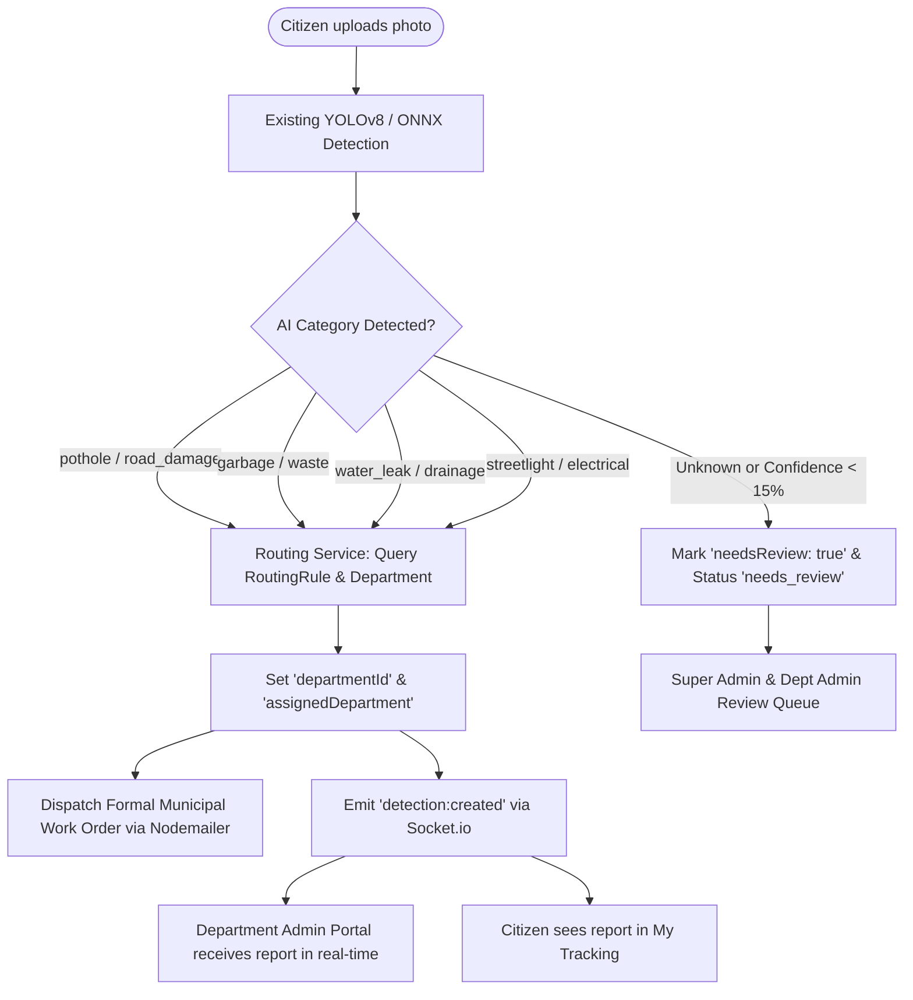

# URBAN EYE — Multi-Role Civic Issue Management Platform
## Implementation & Architecture Plan: Super Admin & Department Admin Portals

**Date:** November 2026  
**Status:** Approved for Implementation (Phase 1 Inspection Complete)  
**Core Constraint:** The existing **Citizen Portal** must not be modified, damaged, rebuilt, redesigned, or have its existing functionality disturbed. All new portals and features are implemented as modular, backward-compatible extensions sharing a unified backend and database.

---

## 1. Existing System Architecture (Phase 1 Inspection)

Following our inspection of the codebase, Urban EYE's technical stack and architecture are documented below:

### 1.1 Technology Stack
- **Backend Framework:** Node.js (v24.x) with Express 4.19.2.
- **Database Engine:** MongoDB via Mongoose 9.9.4. Connects to MongoDB Atlas with an automated fallback to in-memory `mongodb-memory-server` (`backend/config/database.js`) to guarantee high availability and fault-tolerant local operation.
- **Geospatial Engine:** 2dsphere index on `location: { type: "Point", coordinates: [lng, lat] }` with automated EXIF GPS extraction (`piexifjs` / `exif-parser`) and geospatial proximity clustering (50m radius, 30-day window) via `clusteringService.js`.
- **AI Inference Engine:**
  - Embedded local ONNX model: `backend/models/urban_eye_yolov8.onnx` executed directly in-process via `onnxruntime-web` (pure WebAssembly, zero native C++ runtime dependencies) and `sharp`.
  - External fallback: Python FastAPI microservice (`process.env.AI_SERVICE_URL`).
  - Classes detected: `pothole` (Roads) and `garbage` (Sanitation).
- **Real-Time Layer:** Socket.io (v4.7.5) with rooms for user alerts (`join:user`) and detection pipelines (`join:job`), broadcasting `detection:created`, `detection:merged`, and `detection:updated`.
- **Dispatch Service:** Nodemailer with Ethereal development mailer and SMTP support for official municipal PDF complaints and automated citizen resolution emails (`dispatchService.js`).
- **Frontend Framework:** React 18.2 with Vite 5.4, Tailwind CSS v3, and React Router DOM v6.
- **State & Context:** `AuthContext.jsx` (JWT token persistence in `localStorage`, Google OAuth, Phone OTP), `LanguageContext.jsx` (multilingual i18n support in English, Hindi, Marathi, Tamil), `ThemeContext.jsx`.
- **Deployment & Proxy:** Vercel reverse proxy (`vercel.json`) routing `/api/*`, `/uploads/*`, and `/socket.io/*` to the Render backend service (`https://urban-eye-wi2j.onrender.com`).

---

## 2. Protected Citizen Portal Assets (Strictly Untouched)

The following components, pages, routes, and workflows are frozen and protected against modification:

| Asset Category | File Path | Protected Functionality |
| :--- | :--- | :--- |
| **Citizen Views** | `frontend/src/pages/CitizenDashboardPage.jsx` | Cyber-teal metrics, quick actions, recent reports. |
| **Citizen Views** | `frontend/src/pages/CitizenReportPage.jsx` | 3-step reporting wizard, AI live scanner, geotag pin, PDF preview, and auto-dispatch. |
| **Citizen Views** | `frontend/src/pages/CitizenReportsPage.jsx` | Civic reports feed, grid/list view, category & status pills. |
| **Citizen Views** | `frontend/src/pages/CitizenTrackingPage.jsx` | Operational tracking table, 3-step progress stepper (`[✓]--[✓]--[ ]`), search & inspection modal. |
| **Citizen Views** | `frontend/src/pages/CitizenMapPage.jsx` | Interactive Google Map with live civic markers. |
| **Citizen Views** | `frontend/src/pages/CitizenAlertsPage.jsx` | Emergency corridors, advisories, TTS reader. |
| **Citizen Views** | `frontend/src/pages/CitizenActivityPage.jsx` | Real-time civic timeline & department progress bars. |
| **Citizen Views** | `frontend/src/pages/UserProfilePage.jsx` | Citizen profile, civic reward points, bookmarks. |
| **Citizen Views** | `frontend/src/pages/CitizenSettingsPage.jsx` | Notification preferences, data export, account settings. |
| **Citizen Views** | `frontend/src/pages/CitizenSupportPage.jsx` | Helpline strips, FAQ search, live chat, callback modal. |
| **Auth Views** | `frontend/src/pages/LoginPage.jsx`, `RegisterPage.jsx` | Email, password, Google OAuth, and phone OTP login. |
| **Citizen Shell** | `frontend/src/layouts/CitizenLayout.jsx`, `Sidebar.jsx`, `TopHeader.jsx` | Cyber-teal responsive shell and holographic Urban EYE logo. |
| **Citizen Modals** | `frontend/src/components/DetectionModal.jsx`, `DetectionCard.jsx` | Inspection modal, formal complaint letter generator, PDF export. |
| **Citizen APIs** | `POST /api/detect`, `POST /api/detect/scan`, `GET /api/detections` | Existing citizen report submission and tracking endpoints. |

---

## 3. Reusable Existing APIs & Services

We can leverage and extend the following backend modules without breaking citizen functionality:

1. **`POST /api/detect`**:
   - Reused as the single ingestion pipeline for citizen incident reporting.
   - Extension: Integrate dynamic department routing via `departmentRoutingService.js` to look up active departments from MongoDB, tagging the detection with `departmentId` and `assignedDepartment`.
2. **`GET /api/detections`**:
   - Already contains role-based querying logic:
     - Citizens only see reports where `submittedBy === user.id` or `reporterIds.includes(user.id)`.
     - Super Admins see all reports across every department.
     - Extension: Department Admins are automatically filtered by `departmentId: req.user.departmentId`.
3. **`GET /api/detections/:id`**:
   - Reused for inspection modals with role authorization check.
4. **`PATCH /api/detections/:id/status`**:
   - Reused to transition issue statuses (`new` $\rightarrow$ `assigned` $\rightarrow$ `in_progress` $\rightarrow$ `work_completed` $\rightarrow$ `resolved`).
   - Reused to trigger automated citizen resolution emails and live WebSocket updates.
5. **`services/socketService.js`**:
   - Reused for real-time live events across all three portals (`detection:created`, `detection:updated`, `detection:merged`).
6. **`services/storageAdapter.js`**:
   - Reused for storing citizen evidence photos and department progress/completion photos.

---

## 4. Required New Backend Modules

### 4.1 Database Models (`backend/models/`)

1. **`Department.js`**:
   ```javascript
   {
     id: String (UUID, unique),
     name: String (e.g., "Roads & Public Works"),
     code: String (e.g., "roads", "sanitation", "electrical", "water", "parks"),
     description: String,
     categories: [String], // e.g., ["pothole", "road_damage"]
     contactEmail: String,
     contactPhone: String,
     headAdminId: String,
     status: { type: String, enum: ['active', 'inactive'], default: 'active' },
     slaHours: { type: Number, default: 48 },
     createdAt: Date
   }
   ```
2. **`AdminRequest.js`**:
   ```javascript
   {
     id: String (UUID, unique),
     applicantName: String,
     email: String,
     phone: String,
     passwordHash: String,
     requestedDepartmentId: String,
     requestedDepartmentName: String,
     officialDesignation: String,
     idBadgeUrl: String,
     status: { type: String, enum: ['pending', 'approved', 'rejected'], default: 'pending' },
     reviewedBy: String,
     reviewedAt: Date,
     rejectionReason: String,
     createdAt: Date
   }
   ```
3. **`AuditLog.js`**:
   ```javascript
   {
     id: String (UUID),
     action: String, // e.g., "DEPARTMENT_CREATED", "ADMIN_APPROVED", "STATUS_UPDATED"
     actorId: String,
     actorName: String,
     actorRole: String, // "super_admin" | "department_admin"
     targetEntity: String, // "department" | "admin_request" | "detection" | "user"
     targetId: String,
     details: mongoose.Schema.Types.Mixed,
     ipAddress: String,
     createdAt: { type: Date, default: Date.now }
   }
   ```
4. **`RoutingRule.js`**:
   ```javascript
   {
     id: String (UUID),
     categoryKey: String, // e.g., "pothole", "garbage", "streetlight", "water_leak", "park_damage"
     categoryLabel: String,
     departmentId: String,
     departmentName: String,
     minConfidenceThreshold: { type: Number, default: 0.15 },
     defaultSeverity: { type: String, default: "medium" },
     autoDispatchEnabled: { type: Boolean, default: true }
   }
   ```
5. **Model Backward-Compatible Additions**:
   - **`User.js`**:
     - `role`: enum expanded from `['user', 'admin']` to `['user', 'admin', 'super_admin', 'department_admin']`. Default remains `'user'`.
     - `departmentId`: String (null for citizens and super admins).
     - `status`: String (`'active' | 'suspended' | 'pending'`, default `'active'`).
   - **`Detection.js`**:
     - `departmentId`: String (links report to `Department`).
     - `assignedTeam`: String.
     - `workNotes`: Array of `{ note, author, authorRole, photoUrl, createdAt }`.
     - `resolutionProof`: `{ notes, beforePhotoUrl, afterPhotoUrl, resolvedBy, verifiedAt }`.
     - `needsReview`: Boolean (default `false`, set to `true` if AI confidence < threshold or category is unmapped).

### 4.2 New Controllers & Routes (`backend/routes/`)

1. **`superAdminRoutes.js` (`/api/super-admin/*`)**:
   - `GET /stats`: Super Admin platform analytics (total reports, active departments, auto-routing success rate, platform health).
   - `GET /departments`, `POST /departments`, `PATCH /departments/:id`, `DELETE /departments/:id`: Department CRUD & activate/deactivate.
   - `GET /requests`, `POST /requests/:id/approve`, `POST /requests/:id/reject`: Admin application review & activation.
   - `GET /admins`, `PATCH /admins/:id/status`, `POST /admins/:id/reset-password`: Manage department administrators.
   - `GET /reports`: Super Admin global reports stream with multi-department filters.
   - `GET /config/ai`, `PATCH /config/ai`: Configurable AI detection thresholds and routing rules.
   - `GET /users`, `PATCH /users/:id/status`: Manage citizen accounts without exposing passwords.
   - `GET /audit-logs`: Immutable platform audit log stream.

2. **`departmentAdminRoutes.js` (`/api/department-admin/*`)**:
   - `GET /dashboard`: Department-scoped KPI stats (assigned, in-progress, resolved, overdue).
   - `GET /reports`: Department-scoped reports (strictly filtered by `req.user.departmentId`).
   - `GET /reports/in-progress`: Active complaints under maintenance.
   - `GET /reports/resolved`: Resolved complaints with completion proof.
   - `POST /reports/:id/work-notes`: Add progress updates, field notes, and progress photos.
   - `POST /reports/:id/resolve`: Upload after-photographs, record resolution details, and trigger citizen notification.
   - `GET /teams`, `POST /teams`: Manage field crews and maintenance personnel.
   - `GET /analytics`: Department-specific resolution speed and SLA tracking.
   - `GET /notifications`: Department incoming alerts and dispatch broadcasts.

3. **`adminRequestPublicRoutes.js` (`/api/admin-requests`)**:
   - `POST /apply`: Public submission form for department administrator applications (stored with status `pending`, no administrator privileges granted upon registration).

### 4.3 New Middleware & Security (`backend/middleware/`)
- **`requireSuperAdmin`**: Ensures `req.user.role === 'super_admin'`.
- **`requireDepartmentAdmin`**: Ensures `req.user.role === 'department_admin'` and validates `req.user.departmentId`.
- **`scopedDepartmentAccess`**: Enforces that Department Admins can only query and mutate reports matching their authenticated `req.user.departmentId`.

---

## 5. Required New Frontend Modules

### 5.1 Super Admin Portal (`/super-admin/*`)
A dedicated, high-density platform management interface adhering to Urban EYE's dark petrol teal visual language:

- **Layout (`SuperAdminLayout.jsx`)**:
  - Distinct navigation sidebar with executive navigation items, system health indicator, and collapsible state.
  - Top header with global search, breadcrumb navigation, and super admin identity card.
- **Pages**:
  1. **Dashboard (`SuperAdminDashboardPage.jsx`)**: Global KPIs (Total Reports, Departments, Active Admins, Pending Requests, Auto-Routing Efficiency, Dept Breakdown).
  2. **Department Management (`SuperAdminDepartmentsPage.jsx`)**: Create, edit, activate/deactivate departments, configure categories and SLAs.
  3. **Admin Requests (`SuperAdminRequestsPage.jsx`)**: Review applicant credentials, inspect badge proofs, approve (triggers account activation) or reject with reason.
  4. **Department Admin Management (`SuperAdminAdminsPage.jsx`)**: Manage active administrators, suspend accounts, view last login timestamps.
  5. **All Reports (`SuperAdminAllReportsPage.jsx`)**: Comprehensive citywide report stream with department, severity, and status filters.
  6. **System & AI Configuration (`SuperAdminAIConfigPage.jsx`)**: Real AI ONNX model metrics, confidence threshold adjusters, dynamic category-to-department routing rules.
  7. **User Management (`SuperAdminUsersPage.jsx`)**: Citizen and administrator account management.
  8. **Audit Logs (`SuperAdminAuditLogsPage.jsx`)**: Tamper-proof audit table tracking administrative actions.

### 5.2 Department Admin Portal (`/dept-admin/*`)
A single, reusable, department-adaptive command center that dynamically loads context based on the authenticated administrator's department:

- **Layout (`DepartmentAdminLayout.jsx`)**:
  - Displays authenticated department badge (e.g. "Roads & Public Works Department" or "Sanitation & Waste Department").
  - Navigation: Dashboard, My Reports, In Progress, Resolved, Field Teams, Analytics, Notifications.
- **Pages**:
  1. **Department Dashboard (`DeptAdminDashboardPage.jsx`)**: Department-specific stats, incoming queue, SLA alerts, urgent hazard notifications.
  2. **My Reports (`DeptAdminReportsPage.jsx`)**: Reports automatically routed to this department with AI confidence, location, and photos.
  3. **In Progress Work Orders (`DeptAdminInProgressPage.jsx`)**: Active repair jobs, progress notes, field crew dispatch.
  4. **Resolved Reports (`DeptAdminResolvedPage.jsx`)**: Completed work records, before-and-after photographic comparisons.
  5. **My Field Teams (`DeptAdminTeamsPage.jsx`)**: Field crew rosters, assigned zones, dispatch schedules.
  6. **Department Analytics (`DeptAdminAnalyticsPage.jsx`)**: SLA compliance, resolution trends, category distribution.
  7. **Department Notifications (`DeptAdminNotificationsPage.jsx`)**: Priority announcements, escalation alerts.

### 5.3 Public Application Portal
- **Page (`DeptAdminApplyPage.jsx` at `/apply-dept-admin`)**:
  - Allows verified civic officers to choose an active department from a dropdown, upload their credentials, and submit an application.
  - Displays confirmation notice explaining that applications undergo Super Admin vetting before activation.

---

## 6. Automatic AI Department Routing Architecture

The end-to-end routing flow preserves 100% of the existing citizen experience while providing automated routing to departments:



---

## 7. Authentication, RBAC, and Security Architecture

1. **Role-Based Access Control (RBAC)**:
   - `CITIZEN` (`role: 'user'`): Access strictly limited to their own reports and citizen portal routes.
   - `SUPER_ADMIN` (`role: 'super_admin'`): Root administrative authority across all departments, users, settings, and audit logs.
   - `DEPARTMENT_ADMIN` (`role: 'department_admin'`): Authority restricted strictly to reports, analytics, and teams of their assigned `departmentId`.
2. **Server-Side Security**:
   - `req.user.departmentId` is **always** extracted from the verified JWT token on the server.
   - Queries for department administrators will always inject `{ departmentId: req.user.departmentId }`.
   - Any attempt to supply an alternate `departmentId` via query params or request payload is ignored.
3. **Super Admin Bootstrapping**:
   - A dedicated bootstrap script `backend/scripts/bootstrap_superadmin.js` creates the initial Super Admin account with a secure bcrypt-hashed password.
   - No public self-registration endpoint exists for Super Admin.

---

## 8. Phased Implementation Roadmap

To maintain system integrity and protect the Citizen Portal, development will proceed in 10 disciplined phases:

```mermaid
flowchart LR
    P1[Phase 1: Architecture Plan] --> P2[Phase 2: Database Models & RBAC]
    P2 --> P3[Phase 3: Super Admin Backend]
    P3 --> P4[Phase 4: Super Admin Frontend]
    P4 --> P5[Phase 5: Department Admin Backend]
    P5 --> P6[Phase 6: Department Admin Frontend]
    P6 --> P7[Phase 7: Public Admin Application]
    P7 --> P8[Phase 8: Auto AI Routing & Status Sync]
    P8 --> P9[Phase 9: Comprehensive Acceptance Testing]
    P9 --> P10[Phase 10: Production Verification & Deploy]
```



- **Phase 1**: Inspection and architectural documentation (**COMPLETE**).
- **Phase 2**: Add backward-compatible models (`Department`, `AdminRequest`, `AuditLog`, `RoutingRule`) and update `User` & `Detection` schemas. Seed standard departments. Create Super Admin bootstrap script.
- **Phase 3**: Implement Super Admin backend APIs (`/api/super-admin/*`) and security middleware.
- **Phase 4**: Build Super Admin Frontend Portal (`/super-admin/*`) with all 8 pages and responsive layouts.
- **Phase 5**: Implement Department Admin backend APIs (`/api/department-admin/*`) with server-enforced department data isolation.
- **Phase 6**: Build Department Admin Frontend Portal (`/dept-admin/*`) with dynamic department branding and all 7 pages.
- **Phase 7**: Implement public Department Admin Application portal (`/apply-dept-admin`) and approval workflows.
- **Phase 8**: Connect automatic AI routing service to dynamic department models, keeping status lifecycle synchronized with citizen "My Tracking".
- **Phase 9**: Execute all 15 acceptance tests from the master prompt to verify that citizen report submission, AI detection, geotagging, and tracking remain untouched.
- **Phase 10**: Build production bundles, verify with zero errors, and commit to `origin/main`.

---

## 9. Master Acceptance Testing Matrix

| Test ID | Test Scenario | Expected Outcome | Verification Method |
| :--- | :--- | :--- | :--- |
| **TEST 1** | Existing citizen login | Citizen logs in successfully with existing credentials / Google Auth. | Automated / Manual auth check |
| **TEST 2** | Existing citizen dashboard | Loads unchanged with exact cyber-teal metrics and layout. | UI regression verify |
| **TEST 3** | Citizen report submission | Upload photo, geotag location, AI detects issue, submits cleanly. | Live upload test |
| **TEST 4** | Existing YOLOv8 detection | Model identifies pothole/garbage and computes confidence. | ONNX inference check |
| **TEST 5** | Pothole auto-routing | Pothole report receives `departmentId` for Roads & Public Works. | Database document inspect |
| **TEST 6** | Garbage auto-routing | Garbage report receives `departmentId` for Sanitation & Waste. | Database document inspect |
| **TEST 7** | Department data isolation | Department Admin sees only reports for their assigned department. | API query verification |
| **TEST 8** | Super Admin department CRUD | Super Admin creates/edits department; immediately visible in system. | API & UI test |
| **TEST 9** | Super Admin request vetting | Super Admin reviews pending request and approves/rejects it. | Admin Requests workflow test |
| **TEST 10** | Approved Dept Admin login | Approved applicant logs into Department Portal with department role. | Login & redirect test |
| **TEST 11** | Department status update | Department Admin updates status to `in_progress` / `resolved`. | PATCH API test |
| **TEST 12** | Citizen live synchronization | Citizen sees updated status in real-time in "My Tracking". | Socket.io event test |
| **TEST 13** | Department isolation bypass | Dept Admin cannot query another department's reports by changing ID. | Security penetration test (403 Forbidden) |
| **TEST 14** | Super Admin global monitor | Super Admin can inspect reports across every department. | Cross-department list check |
| **TEST 15** | Zero citizen regression | All citizen pages, maps, alerts, profiles remain 100% operational. | Full regression audit |

---
*Urban EYE Platform Architecture Plan — Designed for Scalable, Secure, Multi-Role Civic Operations.*

